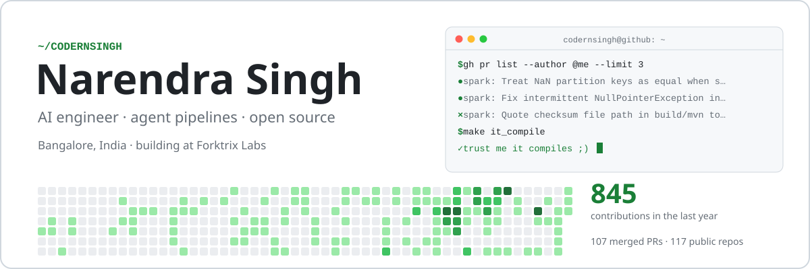
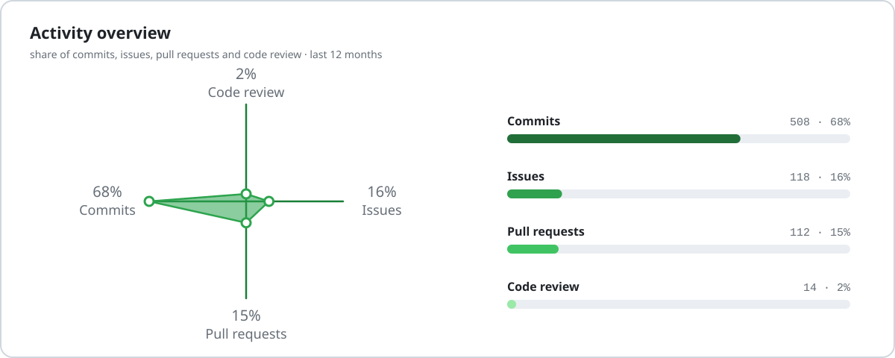
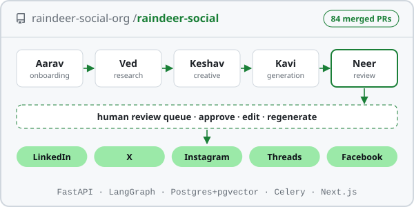
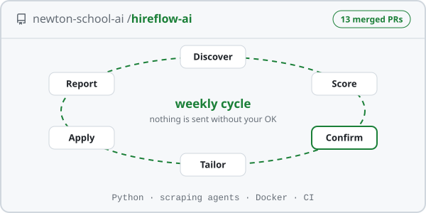
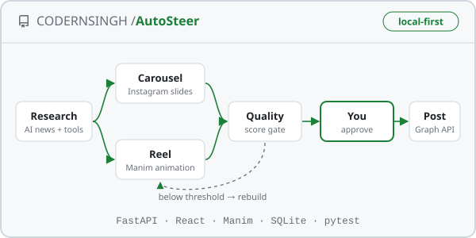
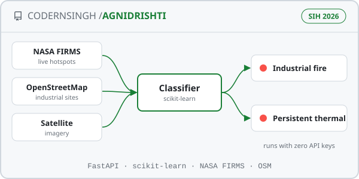
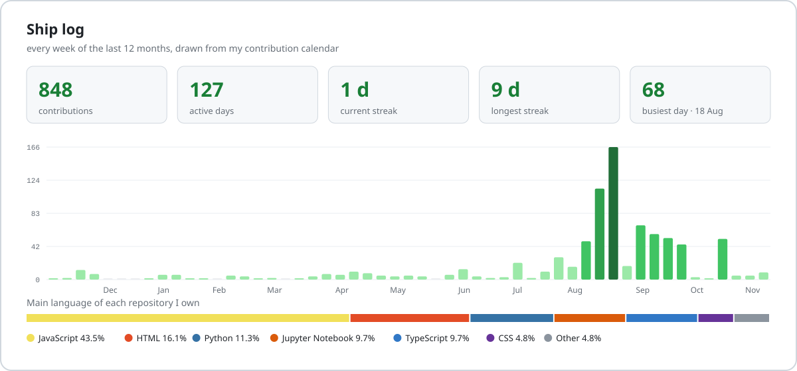
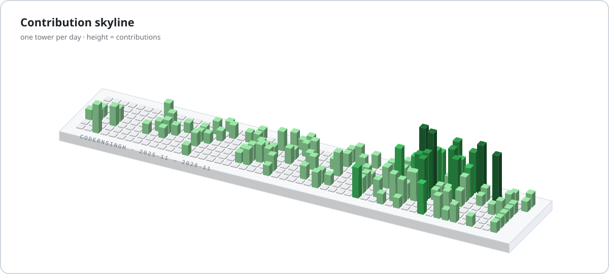
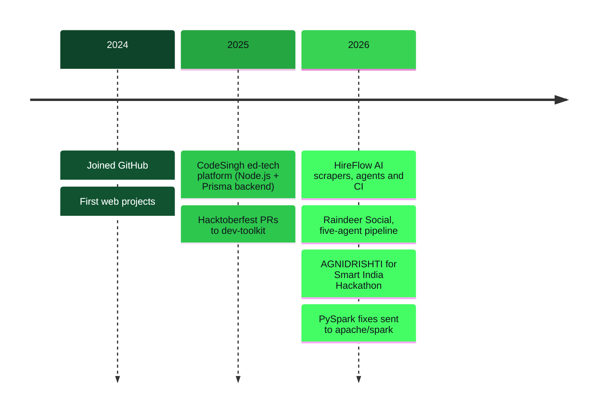

<a href="https://github.com/CODERNSINGH">
  <picture>
    <source media="(prefers-color-scheme: dark)" srcset="assets/header-dark.svg">
    
  </picture>
</a>

<p align="center">
  
</p>

<p align="center">
  <a href="https://linkedin.com/in/codernsingh"></a>
  <a href="https://x.com/codernsingh"></a>
  <a href="https://youtube.com/@codernsingh"></a>
  <a href="https://masternow.in"></a>
  <a href="https://forktrix.com"></a>
  
  
</p>

$$P(\texttt{it compiles} \mid \texttt{git push}_{\text{narendra}}) \;=\; 1 - \varepsilon, \qquad \varepsilon \to 0 \text{ one merged PR at a time}$$

## 🟢 Agents × open source

> I build AI products that do real work, and I keep a human in the loop where it matters.

- **Building:** [Raindeer Social](https://github.com/raindeer-social-org/product-raindeer-social), five named LangGraph agents that take a brand from website to published post. Most of it landed as small, reviewable PRs.
- **Upstream:** PySpark fixes in [apache/spark](https://github.com/apache/spark), scraping and agent work in [HireFlow AI](https://github.com/newton-school-ai/hireflow-ai_1), Hacktoberfest tools in [dev-toolkit](https://github.com/heysaiyad/dev-toolkit). Each fix starts from an issue.
- **Drawn to:** agent pipelines, LLM apps that ship, data and ML on real signals (satellites, ECGs, ride data), and developer tools for the terminal and the browser.
- **Teaching:** notes from my [AIRIS sessions](https://github.com/CODERNSINGH/airis), [Gen-AI notes](https://github.com/CODERNSINGH/Gen-AI-with-Narendra-Singh) and videos on [YouTube](https://youtube.com/@codernsingh).
- **Say hi:** [LinkedIn](https://linkedin.com/in/codernsingh) · [X](https://x.com/codernsingh) · IST (UTC+5:30). Happy to pair on an issue.

<picture>
  <source media="(prefers-color-scheme: dark)" srcset="assets/generated/activity-dark.svg">
  
</picture>

## 🌍 Upstream contributions

<!--UPSTREAM:START-->
**16 merged · 3 in review · 4 repositories** <sub>(auto-updated daily)</sub>

| | project | pull request | status | opened |
|:-:|:--|:--|:--|:--|
|  | [apache/spark](https://github.com/apache/spark) <sub>★ 44.5k</sub> | [[SPARK-60648][PS] Support ordering comparisons between boolean and numeric pandas-on-Spar…](https://github.com/apache/spark/pull/60298) | 🟢&nbsp;in&nbsp;review | Nov 2026 |
|  | [apache/spark](https://github.com/apache/spark) <sub>★ 44.5k</sub> | [[SPARK-60594][PYTHON] Treat NaN partition keys as equal when splitting Python UDTF TABLE…](https://github.com/apache/spark/pull/60233) | 🟢&nbsp;in&nbsp;review | Nov 2026 |
|  | [newton-school-ai/hireflow-ai_1](https://github.com/newton-school-ai/hireflow-ai_1) | [Close issue 26: working Docker deployment + fix broken prep guide link](https://github.com/newton-school-ai/hireflow-ai_1/pull/59) | 🟢&nbsp;in&nbsp;review | Sep 2026 |
|  | [newton-school-ai/hireflow-ai_1](https://github.com/newton-school-ai/hireflow-ai_1) | [feat: add EmailService for weekly report delivery (Issue #21)](https://github.com/newton-school-ai/hireflow-ai_1/pull/50) | 🟣&nbsp;merged | Jul 2026 |
|  | [newton-school-ai/hireflow-ai_1](https://github.com/newton-school-ai/hireflow-ai_1) | [feat: add ReportGenerator and weekly report API (Issue #20)](https://github.com/newton-school-ai/hireflow-ai_1/pull/49) | 🟣&nbsp;merged | Jul 2026 |
|  | [Aniket-bit7/SectionA_G1_Rapido_Ride_Analysis](https://github.com/Aniket-bit7/SectionA_G1_Rapido_Ride_Analysis) | [Updated EDA - Narendra Singh](https://github.com/Aniket-bit7/SectionA_G1_Rapido_Ride_Analysis/pull/8) | 🟣&nbsp;merged | Apr 2026 |
|  | [heysaiyad/dev-toolkit](https://github.com/heysaiyad/dev-toolkit) <sub>★ 22</sub> | [Solve UI issue Typing Animation and UI issue](https://github.com/heysaiyad/dev-toolkit/pull/324) | 🟣&nbsp;merged | Oct 2025 |
|  | [heysaiyad/dev-toolkit](https://github.com/heysaiyad/dev-toolkit) <sub>★ 22</sub> | [feat: Simple 'Internet Speed' Test Tool #270 and Solved UI Issue UI I…](https://github.com/heysaiyad/dev-toolkit/pull/292) | 🟣&nbsp;merged | Oct 2025 |
<!--UPSTREAM:END-->

## 🧪 Flagship projects

<table>
<tr>
<td width="50%" valign="top">

<a href="https://github.com/raindeer-social-org/product-raindeer-social"><picture><source media="(prefers-color-scheme: dark)" srcset="assets/cards/raindeer-dark.svg"></picture></a>

### [Raindeer Social](https://github.com/raindeer-social-org/product-raindeer-social)
AI-native social media manager. **Aarav** interviews the brand, **Ved** researches what's working, **Keshav** writes the brief, **Kavi** writes and draws the post, **Neer** reviews it. Then a human approves it and it goes out.

> Publishing to LinkedIn, X, Instagram, Threads and Facebook · Celery jobs for scheduling and engagement polling

`FastAPI` `LangGraph` `Postgres + pgvector` `Next.js`

</td>
<td width="50%" valign="top">

<a href="https://github.com/newton-school-ai/hireflow-ai_1"><picture><source media="(prefers-color-scheme: dark)" srcset="assets/cards/hireflow-dark.svg"></picture></a>

### [HireFlow AI](https://github.com/newton-school-ai/hireflow-ai_1)
Career autopilot for students. It finds openings, scores them against your resume, tailors a resume per company, fills the forms and sends a weekly report with a prep guide. **Nothing is submitted without your OK.**

> I built the Lever + Greenhouse scrapers, form filler, CAPTCHA recovery, company-intel agent, weekly report and CI

`Python` `agents` `Docker` `GitHub Actions`

</td>
</tr>
<tr>
<td width="50%" valign="top">

<a href="https://github.com/CODERNSINGH/AutoSteer"><picture><source media="(prefers-color-scheme: dark)" srcset="assets/cards/studio-dark.svg"></picture></a>

### [AI Editorial Studio](https://github.com/CODERNSINGH/AutoSteer)
A local-first engine for an AI news page. It researches tools and news, builds Instagram carousels and **Manim-animated reels**, scores them against a quality gate, waits for your approval and publishes through Meta's Graph API.

> Demo mode runs with no keys · the test suite includes a real Manim render

`FastAPI` `React` `Manim` `SQLite`

</td>
<td width="50%" valign="top">

<a href="https://github.com/CODERNSINGH/SpaceXtra---SIH26162"><picture><source media="(prefers-color-scheme: dark)" srcset="assets/cards/agnidrishti-dark.svg"></picture></a>

### [AGNIDRISHTI](https://github.com/CODERNSINGH/SpaceXtra---SIH26162)
Detects and classifies industrial fires and persistent heat sources from **NASA FIRMS** hotspots, OpenStreetMap and satellite imagery. Built for Smart India Hackathon 2026, problem statement 26162.

> Runs with zero API keys · an in-app page says plainly what is real and what is placeholder

`Python` `FastAPI` `scikit-learn`

</td>
</tr>
</table>

## 🛠 How I work

| practice | where you can see it |
|:--|:--|
| Issue first, then the fix | Every [HireFlow AI](https://github.com/newton-school-ai/hireflow-ai_1/pulls?q=author%3ACODERNSINGH) PR closes a numbered issue; the Spark PRs carry their JIRA ticket |
| Small PRs with clear names | Raindeer Social shipped as [dozens of scoped PRs](https://github.com/raindeer-social-org/product-raindeer-social/pulls?q=author%3ACODERNSINGH+is%3Amerged) like `feat(agents): …` and `fix(api): …` |
| A human signs off | Raindeer's review queue, HireFlow's weekly confirm step and the Editorial Studio's approval gate: the AI drafts, a person decides |
| Tests that run the real thing | The Editorial Studio's suite renders an actual Manim video, not a mock |
| CI from day one | I added the backend and frontend CI workflows to HireFlow AI |
| Honest prototypes | AGNIDRISHTI runs with no keys and has a page that lists what is real and what is still a placeholder |

## 📊 More projects

| project | what | headline | stack |
|:--|:--|:--|:--|
| [**Forktrix-Chat**](https://github.com/CODERNSINGH/turbo-chat) | Real-time chat rooms in the terminal | One `npx` command · rooms hashed with bcrypt · messages never stored | Node.js · Socket.io · Postgres |
| [**SplitScreen**](https://github.com/CODERNSINGH/splitScreen) | Chrome extension for multitasking | Every panel is a real Chrome window, so sites that block iframes still work | JavaScript · Chrome APIs |
| [**Spindly**](https://github.com/CODERNSINGH/spindly) | Expense tracker | Built end to end with Claude Code | CSS · JavaScript |
| [**nstbuddy**](https://github.com/CODERNSINGH/nstbuddy-version-3) | Go-to helper for NST questions | Version 3, plus a [macOS app](https://github.com/CODERNSINGH/nstbuddy-Sage) | TypeScript |
| [**ECG Analysis**](https://github.com/CODERNSINGH/ECG-Analysis-Gloab-circuit-Hackathon) | Heart-signal analysis for a hackathon | Notebook-first exploration of ECG data | Python · Jupyter |
| [**Rapido Ride Analysis**](https://github.com/CODERNSINGH/DVA-Rapido-Dashboard) | Data and visual analytics on ride data | Team EDA and dashboard | pandas · Jupyter |

## 📈 Ship log

<picture>
  <source media="(prefers-color-scheme: dark)" srcset="assets/generated/shiplog-dark.svg">
  
</picture>

<sub>Drawn daily by <a href="scripts/build_profile.py"><code>scripts/build_profile.py</code></a> (standard-library Python), which also keeps the tables on this page current.</sub>

### 🚢 Recently shipped
<!--RECENT:START-->
| repo | what | lang | pushed |
|:--|:--|:--|:--|
| [**codix**](https://github.com/CODERNSINGH/codix) | Learn coding and maths by answering simple questions | `—` | 8 days ago |
| [**airis**](https://github.com/CODERNSINGH/airis) | Notes and resources from my AIRIS sessions | `Jupyter Notebook` | 2 weeks ago |
| [**AutoSteer**](https://github.com/CODERNSINGH/AutoSteer) | AI Editorial Studio: researches AI news, renders carousels + Manim reels, publishes after you… | `Python` | 2 weeks ago |
| [**nstbuddy-Sage**](https://github.com/CODERNSINGH/nstbuddy-Sage) | macOS app for nstbuddy, the go-to helper for NST questions | `JavaScript` | 3 weeks ago |
| [**airis-lecture-01**](https://github.com/CODERNSINGH/airis-lecture-01) | AIRIS lecture 01: intro to AI and the toolkit | `—` | 7 weeks ago |
| [**turbo-chat**](https://github.com/CODERNSINGH/turbo-chat) | Forktrix-Chat: real-time chat rooms in your terminal over Socket.io, runs with npx | `JavaScript` | 7 weeks ago |
<!--RECENT:END-->

## 🏙️ Contribution skyline

<picture>
  <source media="(prefers-color-scheme: dark)" srcset="assets/generated/skyline-dark.svg">
  
</picture>

## 🛤️ Trajectory



## 🧰 Toolchain

<p>
  <b>AI & data</b><br>
  <br>
  
  
  
  
  
  
  
  
  
</p>
<p>
  <b>Backend & infra</b><br>
  <br>
  
  
</p>
<p>
  <b>Frontend & languages</b><br>
  
</p>

<details>
<summary><b>🤖 <code>gh api users/CODERNSINGH</code></b> (the extended edition)</summary>

<!--CARD:START-->
```json
{
  "login": "CODERNSINGH",
  "name": "Narendra Singh",
  "bio": "trust me it compiles ;)",
  "company": "Forktrix Labs",
  "location": "Bangalore, India",
  "building": [
    "Raindeer Social",
    "HireFlow AI",
    "AI Editorial Studio",
    "AGNIDRISHTI"
  ],
  "contributes_to": [
    "Aniket-bit7/SectionA_G1_Rapido_Ride_Analysis",
    "apache/spark",
    "heysaiyad/dev-toolkit",
    "newton-school-ai/hireflow-ai_1"
  ],
  "languages": [
    "JavaScript",
    "HTML",
    "Python",
    "Jupyter Notebook",
    "TypeScript",
    "CSS"
  ],
  "stats": {
    "public_repos": 117,
    "contributions_last_12mo": 847,
    "pull_requests_merged": 107,
    "current_streak_days": 9,
    "longest_streak_days": 9,
    "followers": 8
  },
  "open_to": [
    "agent pipelines",
    "open-source bugs",
    "pairing on an issue"
  ],
  "updated_at": "2026-11-11"
}
```
<!--CARD:END-->

</details>

---

<picture>
  <source media="(prefers-color-scheme: dark)" srcset="assets/generated/snake-dark.svg">
  
</picture>

<p align="center">
  <sub>Built in the open. The header, activity overview, project cards, ship log, skyline and snake are drawn by this repo's own <a href=".github/workflows/refresh-profile.yml">GitHub Action</a> and <a href="scripts">scripts</a>. Fork anything.</sub>
</p>
